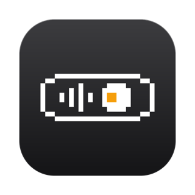
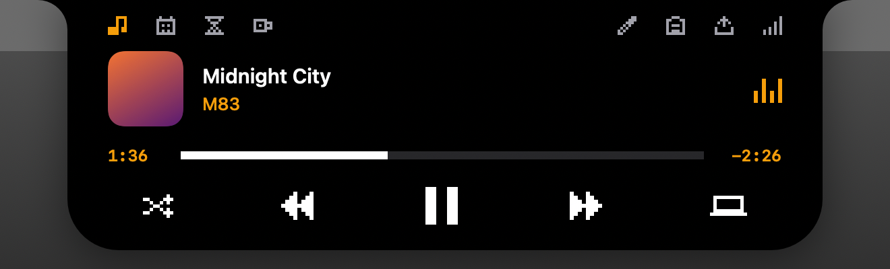
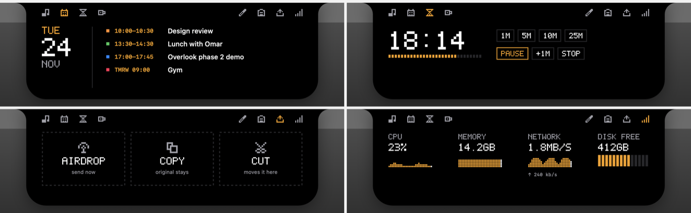
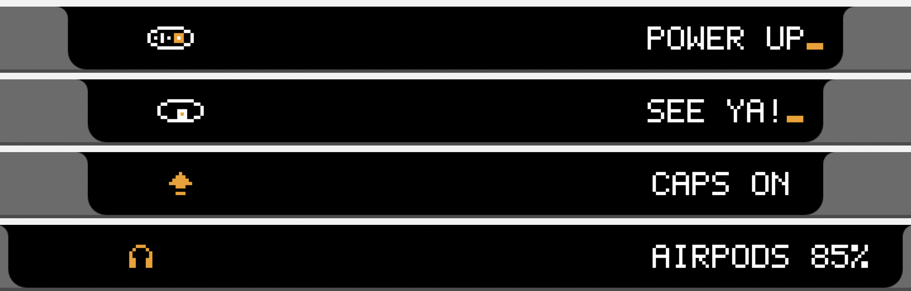
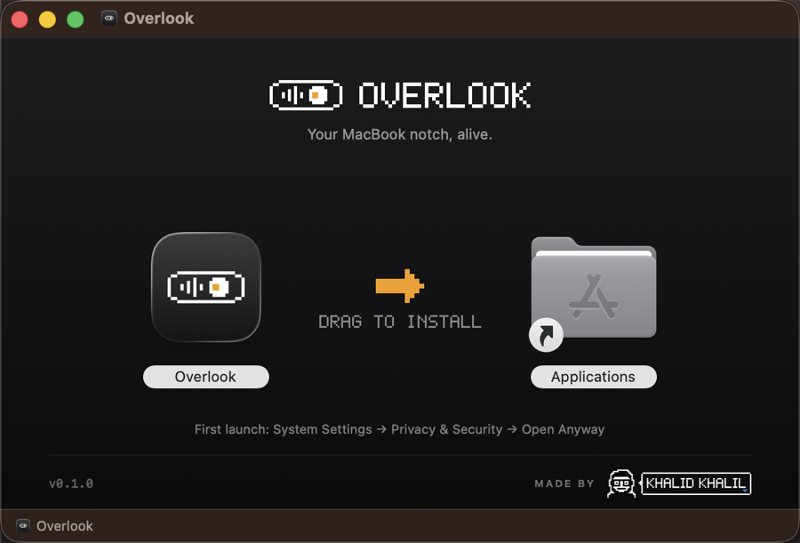

  

<h1 align="center">Overlook</h1>

  <b>Your MacBook notch, alive.</b> 
  Music, timers, files and live updates, right where the camera is.

  

  
  
  

  

Overlook turns the notch into a small island that opens when you point at it. It shows what's playing and lets you control it. It also gives you a timer, your calendar, a clipboard history, a place to park files, and a quick look at your Mac. When something happens (you plug in the charger, connect AirPods, turn on Caps Lock), the closed notch reacts with a small pixel animation and a word.

## Download

Get **[Overlook.dmg](https://github.com/kakhaliel/Overlook-Releases/releases/latest/download/Overlook.dmg)** (latest version) or pick a version on the [Releases](https://github.com/kakhaliel/Overlook-Releases/releases) page.

## Features

### 🎵 Music
Apple Music, Spotify, and browser players (YouTube, YouTube Music, Spotify Web, Anghami, SoundCloud… in Safari, Chrome, Brave, Edge and Arc). Artwork, title, artist, a seekable progress bar, shuffle, play/pause/next/previous, and a menu to choose the sound output. While music plays, the closed notch shows the artwork and live bars.

### 🗂️ Tabs in the open notch

| Tab | What it does |
|---|---|
| **Calendar** | Today's date and your next events (today and tomorrow) |
| **Timer** | 1 / 5 / 10 / 25 min, pause, +1 min. The time shows next to the closed notch, and "TIME'S UP" types out when it ends |
| **Mirror** | Your camera, mirrored. It's on only while the tab is open |
| **Color Picker** | Pick any color on screen; HEX is copied right away. Keeps a history |
| **Clipboard** | The last 25 things you copied. Click one to copy it again. Password-manager entries are skipped |
| **Shelf** | Drag files at the notch. Drop them on **AirDrop** (send now), **Copy** (keep a copy) or **Cut** (move them in). Drag them out to move them on |
| **System** | CPU, memory, network and free disk, with small pixel graphs |

### ⚡ Live moments on the closed notch

- **Charging**: a pixel plug slides in, sparks, and a happy word types out. Unplug it and the plug slides away, and the eye looks sad.
- **Camera & mic**, **headphones** (name and battery), **Caps Lock**, **downloads** (progress, then "DOWNLOADED"), **volume**, and **picked colors**.
- Add your first name in Settings and the notch talks to you: "THX KHALID!", "HI KHALID!", "MORNING KHALID".

### 🎨 Make it yours
- **Style**: *Pixel* (Overlook's own 1-bit look) or *Classic* (standard macOS icons and font).
- **Color**: amber by default, or any of 8 presets, or your own.
- Turn any tab or notification on or off.
- On launch, the logo draws itself in the notch (you can switch this off).

## Install

1. Open `Overlook.dmg` and drag **Overlook** into **Applications**.
2. Open Overlook. The first time, macOS says it can't check the app: click **Done**, then go to **System Settings → Privacy & Security** and click **Open Anyway**. (Overlook is signed ad-hoc, without an Apple Developer ID.)
3. Overlook lives in the menu bar and the notch. Point at the notch to open it. Settings are in the menu-bar icon → **Settings…**

**Browser music** needs one switch in each browser, once:
- Safari: Settings → Advanced → *Show features for web developers*, then Develop → *Allow JavaScript from Apple Events*.
- Chrome / Brave / Edge / Arc: View → Developer → *Allow JavaScript from Apple Events*.

## Permissions

Overlook asks only when you use a feature, and you can say no to any of them.

| Permission | Why |
|---|---|
| **Automation** (Music, Spotify, browsers) | Read what's playing and control playback |
| **Calendars** | Show your next events in the Calendar tab |
| **Camera** | The Mirror tab. The camera is on only while that tab is open |
| **Downloads folder** | Show download progress on the notch |

Everything stays on your Mac. Overlook sends nothing anywhere.

## Requirements

macOS 14 or newer, Apple Silicon or Intel. Made for MacBooks with a notch; on other Macs it shows a small pill at the top of the screen.

## What's new

See [CHANGELOG.md](CHANGELOG.md).

---

This repository holds releases only; the source code is private.

  Developed by <a href="https://khalidkhalil.dev">Khalid Khalil</a> · info@khalidkhalil.dev · © 2026 Khalid Khalil

